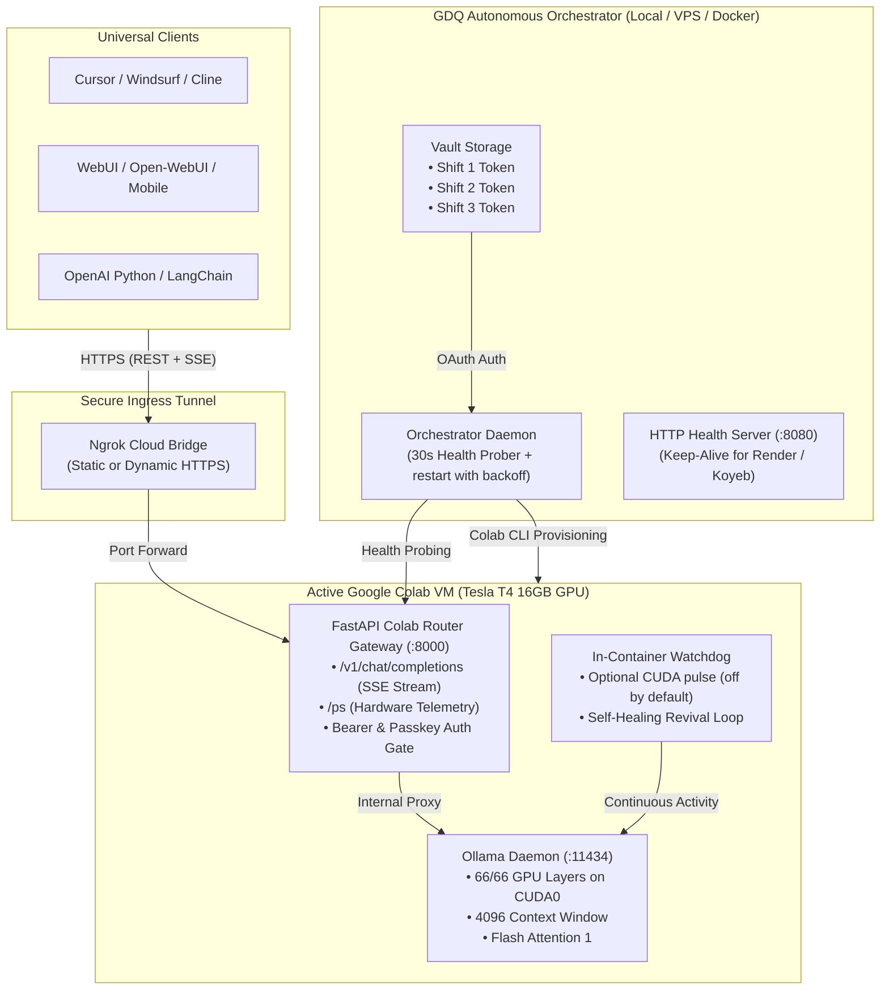

# 🌌 Colab Router

<div align="center">

[](LICENSE)
[](https://www.python.org/downloads/)
[](https://fastapi.tiangolo.com)
[](https://ollama.com)
[](https://colab.research.google.com/github/agenticversestudio/colab-router/blob/main/colab/notebook.ipynb)

**Run Qwen 3.8 27B on a free Google Colab T4 as an OpenAI-compatible server — on demand, with honest limits.**

[Quick Start](#-quick-start) • [Architecture](#-architecture) • [Honest Limits](#-honest-limits-read-this-first) • [Hindi Guide (हिंदी गाइड)](#-hindi-quick-guide-हिंदी-मार्गदर्शिका) • [Docs](docs/)

</div>

---

## 🌟 Overview

**Colab Router** (Colab Router) is an end-to-end, production-grade infrastructure toolkit that allows anyone to run large language models (up to **27 Billion parameters** on a free **Tesla T4 16GB GPU**, or up to **72B** on L4/A100) with **100% GPU offloading**, **OpenAI-compatible streaming endpoints**, and **autonomous multi-account shift rotation for continuous 24/7 uptime**.

### Key Highlights:
- 🚀 **27B model on a free T4:** `qwen3.8-27b-uncensored` (IQ4_XS, ~14.3 GB) fits in the T4's VRAM with a short context (4096).
- 🔌 **OpenAI-compatible:** `/v1/chat/completions` (SSE streaming) and `/v1/models`, works with Cursor, Cline, Open-WebUI, the OpenAI SDK.
- 🛡️ **Self-healing inside the VM:** the watchdog restarts dead Ollama / gateway processes.
- 📊 **Truthful health:** `/ps` says `engine: ollama` only when the model is really loaded on the GPU.
- 🔒 **No secrets in code:** everything comes from `.env` / notebook variables; the gateway rejects all requests until a key is configured.
- 🤖 **Stuck? Just say "restart karo":** open the repo in your AI IDE (Antigravity, Claude Code, Codex, OpenCode...). [`AGENTS.md`](AGENTS.md) makes it run `python scripts/doctor.py`, explain the cause with evidence, and guide you. No long prompt to paste. See [`RESTART_GUIDE.md`](RESTART_GUIDE.md).

## ⚠️ Honest limits (read this first)

- **Not 24/7.** Free Colab sessions last *at most 12 hours* and often end sooner; runtimes time out when idle. Use it "switch on, work, switch off".
- **GPU is not guaranteed.** Sometimes Google answers *Service Unavailable*. Wait 10-60 min or try tomorrow. Heavy daily use gets less.
- **Only Qwen 3.8 27B runs here.** GLM-5 (744B) and DeepSeek V4 (284B-1.6T) need hundreds of GB of memory; they do not run on Colab. Use them via the OpenCode app's free hosted models (limited time).
- **Short context** (~4096) because the T4 VRAM is tight. Model reloads on every new session (~2-8 min).
- **Rules:** Colab's FAQ disallows web-service hosting, remote proxies, and using multiple accounts to work around limits. The ngrok tunnel and the optional multi-account mode touch those rules, so use them knowingly and only for your own light use. Multi-account rotation is **off by default** and did not improve uptime in real logs.

Source: [Colab FAQ](https://research.google.com/colaboratory/intl/en-GB/faq.html).

---

## 🏗️ Architecture



---

## 🚀 Quick Start

Choose the deployment method that fits your workflow:

### Option 1: 1-Click Interactive Notebook (Beginner / Quick Testing)

1. Open [Google Colab](https://colab.research.google.com).
2. Upload [`colab/notebook.ipynb`](colab/notebook.ipynb).
3. Set Runtime to **T4 GPU** (`Runtime` ➔ `Change runtime type` ➔ `T4 GPU`).
4. Enter your free [Ngrok Auth Token](https://dashboard.ngrok.com/get-started/your-authtoken) and click **Run All** (`Ctrl + F9`).
5. Your public OpenAI endpoint URL will be displayed in the output!

---

### Option 2: Orchestrator (advanced, best-effort — restarts the shift when it dies)

#### Step 1: Clone & Install Dependencies
```bash
git clone https://github.com/agenticversestudio/colab-router.git
cd colab-router
pip install -r requirements.txt
cp .env.example .env
```

#### Step 2: Configure Environment
Edit `.env` with your preferred credentials:
```bash
NGROK_AUTHTOKEN=your_ngrok_authtoken_here
NGROK_DOMAIN=your_custom_domain.ngrok-free.dev  # (Optional)
GDQ_API_KEY=sk-my-secret-key
```

#### Step 3: Archive Multi-Account Tokens
Authenticate your Google accounts into the vault:
```bash
python orchestrator/auth_helper.py
```
*Follow the browser prompts to log into your Google account (one is enough). More accounts are optional and risky; see Honest limits.*

#### Step 4: Run the Orchestrator
- **Windows:** Double-click `orchestrator/run_orchestrator.bat` or run `python orchestrator/orchestrator.py`
- **Linux / macOS:** `./orchestrator/run_orchestrator.sh`
- **Docker:** `docker-compose -f orchestrator/docker-compose.yml up -d`

---

## 🔁 What the orchestrator actually does

- Starts a Colab T4 session, uploads the gateway, waits until the model is really loaded.
- Checks health every 30 s. If the model/gateway dies it tries an in-VM fix, then starts a fresh session.
- If Google has no free GPU it waits **5, 10, 20, 40, 60 min** and retries (it does not hammer).
- Uses **one account** by default (`ACCOUNT_COUNT=1`). Setting 2-3 enables account hand-over; Colab's FAQ disallows using multiple accounts to work around limits, so that is at your own risk.

Real-world result from the maintainers' logs (12.6 days): the server was online roughly a fifth of the time, and Google returned *Service Unavailable* thousands of times. Plan for gaps.

---

## 📊 Live Verification & Benchmarks

> Example outputs from the maintainers' own runs. Your numbers will differ.

Once running, verify system health using the built-in diagnostic tools:

### Hardware Telemetry Probe
```bash
python scripts/check_status.py
```
```text
=================================================================
🔍 Probing Colab Router Gateway: https://your-domain.ngrok-free.dev
=================================================================
[✓] Gateway Liveness: healthy

📊 Hardware GPU Telemetry:
  Tesla T4, 14557 MiB, 356 MiB, 0 %

🧠 Ollama Active Runner:
  NAME                           ID       SIZE   PROCESSOR   CONTEXT  UNTIL
  qwen3.8-27b-uncensored:latest  6d06c83  14 GB  100% GPU    4096     Forever

✅ System is operational!
```

### SSE Stream Benchmark
```bash
python scripts/test_stream.py
```
```text
=================================================================
⚡ First Token Latency (TTFT): 0.68s
📈 Total Generated Tokens:    114
⏱️ Total Generation Time:     9.66s
🚀 Throughput:                 11.8 tokens/second
=================================================================
```

---

## 🔌 Connecting to Your Clients

### Cursor / Windsurf / Cline (VS Code)
1. Go to **Settings ➔ Models / OpenAI Provider**.
2. **Base URL:** `https://your-domain.ngrok-free.dev/v1`
3. **API Key:** `sk-my-secret-key` (from `.env`)
4. **Model Name:** `qwen3.8-27b-uncensored`

### Python SDK (`openai`)
```python
from openai import OpenAI

client = OpenAI(
    base_url="https://your-domain.ngrok-free.dev/v1",
    api_key="sk-my-secret-key"
)

response = client.chat.completions.create(
    model="qwen3.8-27b-uncensored",
    messages=[{"role": "user", "content": "Write a python function to check prime numbers."}],
    stream=True
)

for chunk in response:
    print(chunk.choices[0].delta.content or "", end="", flush=True)
```

---

## 🇮🇳 Hindi Quick Guide (हिंदी मार्गदर्शिका)

**Colab Router** free Google Colab ke T4 GPU par **Qwen 3.8 27B** ko chalane ka toolkit hai, jab aapko chahiye tab.

1. **Chalane ka tarika:** `colab/notebook.ipynb` Colab mein kholo, `T4 GPU` chuno, apna ngrok token daalo, `Run all` dabao.
2. **Kitni der chalega:** free Colab mein ek session max 12 ghante, aksar kam. **24×7 nahi hota.**
3. **Kabhi GPU nahi milega:** "Service Unavailable" aaye to 10-60 minute baad ya kal try karo.
4. **Sirf Qwen 27B chalta hai.** GLM-5 aur DeepSeek V4 bahut bade hain, Colab par nahi chalte. Unke liye OpenCode app ke free hosted models use karo (limited time).
5. **Band ho jaye to:** repo ko AI IDE mein kholo aur bolo `restart karo`. Ya `python scripts/doctor.py` chalao. Guide: [`RESTART_GUIDE.md`](RESTART_GUIDE.md).
6. **Kuch secret repo mein nahi hai.** Sab kuch `.env` ya notebook ke variables mein jaata hai.

---

## 📁 Repository Structure

```text
colab-router/
├── .env.example              # Safe configuration template (No secrets)
├── .gitignore                # Comprehensive Git ignore rules
├── LICENSE                   # MIT License
├── README.md                 # Complete Master Documentation
├── AGENTS.md                 # Standing rules for AI IDEs (also GEMINI.md, CLAUDE.md)
├── AGENT_PROMPT.md           # Fallback one-liner if your IDE ignores AGENTS.md
├── RESTART_GUIDE.md          # Simple guide: start / restart / what the errors mean
├── requirements.txt          # Python dependencies
├── colab/
│   ├── colab_payload.py      # Autonomous payload runner executed in Colab
│   ├── hybrid_server.py      # Decoupled FastAPI OpenAI streaming gateway
│   └── notebook.ipynb        # 1-Click interactive Jupyter Notebook
├── orchestrator/
│   ├── orchestrator.py       # Shift orchestrator (best-effort, 1 account by default)
│   ├── auth_helper.py        # Interactive CLI vault authenticator
│   ├── run_orchestrator.bat  # Windows 1-click launcher
│   ├── run_orchestrator.sh   # Linux/macOS launcher
│   ├── Dockerfile            # Container definition for Koyeb/Render/VPS
│   └── docker-compose.yml    # Docker Compose definition
├── scripts/
│   ├── doctor.py             # Read-only diagnosis: why is it not working?
│   ├── check_status.py       # Hardware telemetry & model verification probe
│   ├── test_stream.py        # SSE latency and speed benchmark tester
│   └── fast_heal.py          # In-container process revival script
└── docs/
    ├── ARCHITECTURE.md       # Memory breakdown and Colab physics
    ├── SETUP_GUIDE.md        # Detailed step-by-step setup guide
    └── MODELS_GUIDE.md       # Supported models & VRAM allocation tables
```

---

## 🔒 Security & Privacy

- **Stateless Compute:** The Colab GPU VM never writes chats, history, or user identity to disk.
- **Client-Side Sovereignty:** User data lives strictly in client applications (e.g. Browser IndexedDB or your IDE).
- **Environment Isolation:** Zero credentials, personal emails, or private domains are stored in git. All tokens are dynamically injected via environment variables.

---

## 📄 License

This project is licensed under the **MIT License** — see the [LICENSE](LICENSE) file for details.
