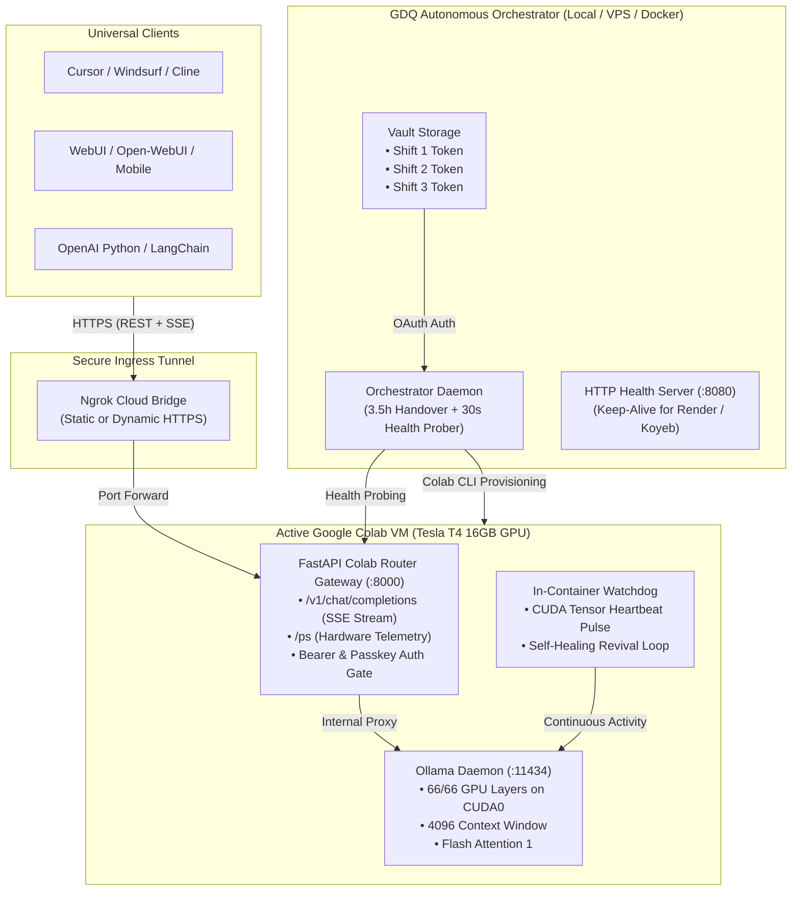

# 🌌 Colab Router

<div align="center">

[](LICENSE)
[](https://www.python.org/downloads/)
[](https://fastapi.tiangolo.com)
[](https://ollama.com)
[](https://colab.research.google.com/github/agenticversestudio/colab-router/blob/main/colab/notebook.ipynb)

**Turn Free Google Colab into a 24/7 Sovereign Autonomous Cloud AI Supercomputer & OpenAI-Compatible Inference Server.**

[Quick Start](#-quick-start) • [Architecture](#-architecture) • [Multi-Account 247 Rotation](#-the-247-multi-account-rotation-formula) • [Hindi Guide (हिंदी गाइड)](#-hindi-quick-guide-हिंदी-मार्गदर्शिका) • [Docs](docs/)

</div>

---

## 🌟 Overview

**Colab Router** (Colab Router) is an end-to-end, production-grade infrastructure toolkit that allows anyone to run large language models (up to **27 Billion parameters** on a free **Tesla T4 16GB GPU**, or up to **72B** on L4/A100) with **100% GPU offloading**, **OpenAI-compatible streaming endpoints**, and **autonomous multi-account shift rotation for continuous 24/7 uptime**.

### Key Highlights:
- 🚀 **100% GPU VRAM Offload:** Fits 27B models (`qwen3.8-27b-uncensored`, `qwen2.5-14b`, `llama3.1-8b`) completely in GPU memory with zero CPU offload bottlenecks (**~12 t/s throughput, 0.68s latency**).
- 🔄 **Autonomous 24/7 Shift Rotation:** Preemptively cycles through 2-3 free Google Colab accounts (3.5-hour shifts) to eliminate compute exhaustion and 24-hour GPU lockouts.
- 🔌 **Universal OpenAI Drop-In:** Exposes `/v1/chat/completions` and `/v1/models` with full Server-Sent Events (SSE) streaming and `reasoning_content` (thinking tokens) support for **Cursor, Windsurf, Cline, Open-WebUI, and custom apps**.
- 🛡️ **In-Container Self-Healing Watchdog:** Active CUDA tensor keep-alive pulse defeats Google Colab idle termination; auto-revives crashed processes inside the container without recreating the VM.
- 📊 **Real-Time Hardware Telemetry:** Dedicated `/ps` endpoint returns live `nvidia-smi` VRAM metrics and active Ollama runner status.
- 🔒 **Zero Credentials Stored on Cloud:** Stateless compute architecture. All configurations use `.env.example` templates; tokens remain securely inside your local vault.

---

## 🏗️ Architecture



---

## 🚀 Quick Start

Choose the deployment method that fits your workflow:

### Option 1: 1-Click Interactive Notebook (Beginner / Quick Testing)

1. Open [Google Colab](https://colab.research.google.com).
2. Upload [`colab/notebook.ipynb`](colab/notebook.ipynb).
3. Set Runtime to **T4 GPU** (`Runtime` ➔ `Change runtime type` ➔ `T4 GPU`).
4. Enter your free [Ngrok Auth Token](https://dashboard.ngrok.com/get-started/your-authtoken) and click **Run All** (`Ctrl + F9`).
5. Your public OpenAI endpoint URL will be displayed in the output!

---

### Option 2: Autonomous 24/7 Multi-Account Orchestrator (Production)

#### Step 1: Clone & Install Dependencies
```bash
git clone https://github.com/agenticversestudio/colab-router.git
cd colab-router
pip install -r requirements.txt
cp .env.example .env
```

#### Step 2: Configure Environment
Edit `.env` with your preferred credentials:
```bash
NGROK_AUTHTOKEN=your_ngrok_authtoken_here
NGROK_DOMAIN=your_custom_domain.ngrok-free.dev  # (Optional)
GDQ_API_KEY=sk-my-secret-key
```

#### Step 3: Archive Multi-Account Tokens
Authenticate your Google accounts into the vault:
```bash
python orchestrator/auth_helper.py
```
*Follow the browser prompts to log into Shift 1, Shift 2, and Shift 3.*

#### Step 4: Run the Orchestrator
- **Windows:** Double-click `orchestrator/run_orchestrator.bat` or run `python orchestrator/orchestrator.py`
- **Linux / macOS:** `./orchestrator/run_orchestrator.sh`
- **Docker:** `docker-compose -f orchestrator/docker-compose.yml up -d`

---

## ⚡ The 24/7 Multi-Account Rotation Formula

Google Colab free-tier GPU instances enforce an account-level limit after ~3.5 to 5 hours of sustained compute. Attempting to force a single account to run for 12 hours results in sudden disconnects and a 24-hour lockout.

Colab Router solves this mathematically using a **3-Account 3.5-Hour Rotation Matrix**:

$$\text{Shift Duration} = 3.5 \text{ hours}$$
$$\text{Full Rotation Cycle} = 3 \times 3.5 = 10.5 \text{ hours}$$
$$\text{Account Rest Period} = 2 \times 3.5 = 7.0 \text{ hours}$$

```
Hour 0.0          3.5           7.0          10.5         14.0
 ├─────────────┼─────────────┼─────────────┼─────────────┤
 ┌─────────────┐
 │Shift 1 (ON) │ ➔ 7.0 Hours Rest (Quota 100% Fully Restores)
 └─────────────┘
               ┌─────────────┐
               │Shift 2 (ON) │ ➔ 7.0 Hours Rest (Quota 100% Restores)
               └─────────────┘
                             ┌─────────────┐
                             │Shift 3 (ON) │ ➔ 7.0 Hours Rest (Quota Restores)
                             └─────────────┘
                                           ┌─────────────┐
                                           │Shift 1 (ON) │ ➔ Loops Infinitely
                                           └─────────────┘
```

The orchestrator seamlessly transfers the static Ngrok domain to the new GPU instance with **zero client reconfiguration**.

---

## 📊 Live Verification & Benchmarks

Once running, verify system health using the built-in diagnostic tools:

### Hardware Telemetry Probe
```bash
python scripts/check_status.py
```
```text
=================================================================
🔍 Probing Colab Router Gateway: https://your-domain.ngrok-free.dev
=================================================================
[✓] Gateway Liveness: healthy

📊 Hardware GPU Telemetry:
  Tesla T4, 14557 MiB, 356 MiB, 0 %

🧠 Ollama Active Runner:
  NAME                           ID       SIZE   PROCESSOR   CONTEXT  UNTIL
  qwen3.8-27b-uncensored:latest  6d06c83  14 GB  100% GPU    4096     Forever

✅ System is operational!
```

### SSE Stream Benchmark
```bash
python scripts/test_stream.py
```
```text
=================================================================
⚡ First Token Latency (TTFT): 0.68s
📈 Total Generated Tokens:    114
⏱️ Total Generation Time:     9.66s
🚀 Throughput:                 11.8 tokens/second
=================================================================
```

---

## 🔌 Connecting to Your Clients

### Cursor / Windsurf / Cline (VS Code)
1. Go to **Settings ➔ Models / OpenAI Provider**.
2. **Base URL:** `https://your-domain.ngrok-free.dev/v1`
3. **API Key:** `sk-my-secret-key` (from `.env`)
4. **Model Name:** `qwen3.8-27b-uncensored`

### Python SDK (`openai`)
```python
from openai import OpenAI

client = OpenAI(
    base_url="https://your-domain.ngrok-free.dev/v1",
    api_key="sk-my-secret-key"
)

response = client.chat.completions.create(
    model="qwen3.8-27b-uncensored",
    messages=[{"role": "user", "content": "Write a python function to check prime numbers."}],
    stream=True
)

for chunk in response:
    print(chunk.choices[0].delta.content or "", end="", flush=True)
```

---

## 🇮🇳 Hindi Quick Guide (हिंदी मार्गदर्शिका)

**Colab Router** ek complete open-source toolkit hai jo aapke **Google Colab ke free GPU (Tesla T4 16GB)** ko ek 24/7 chalne wale **AI Supercomputer & OpenAI API Server** me convert kar deta hai.

### Kaise Kaam Karta Hai?
1. **1-Click Run:** Agar aapko turant chalana hai, to `colab/notebook.ipynb` ko Colab me kholiye, apna Ngrok token daliye aur **Run All** dabaiye.
2. **24/7 Bina Ruke Setup:** Agar aapko 24 ghante lagatar chalana hai, to `orchestrator/auth_helper.py` chala kar apne 2 ya 3 Google accounts ke token save kar lijiye.
3. **Auto Shift Rotation:** Orchestrator har 3.5 ghante me automatic agle account par shift kar deta hai, jisse Google Colab ka quota kabhi khatam nahi hota aur system bina ruke 24/7 live rehta hai.
4. **100% GPU Speed:** 27 Billion parameter model (`qwen3.8-27b-uncensored`) pure 100% Tesla T4 GPU VRAM me lock hota hai, jisse first token 0.7 second me aata hai.
5. **Zero Secret Leak:** Koi bhi password, token ya private email repo me save nahi hoti, sab kuch `.env` file aur local vault me safe rehta hai.

---

## 📁 Repository Structure

```text
colab-router/
├── .env.example              # Safe configuration template (No secrets)
├── .gitignore                # Comprehensive Git ignore rules
├── LICENSE                   # MIT License
├── README.md                 # Complete Master Documentation
├── requirements.txt          # Python dependencies
├── colab/
│   ├── colab_payload.py      # Autonomous payload runner executed in Colab
│   ├── hybrid_server.py      # Decoupled FastAPI OpenAI streaming gateway
│   └── notebook.ipynb        # 1-Click interactive Jupyter Notebook
├── orchestrator/
│   ├── orchestrator.py       # Multi-account 24/7 cloud daemon
│   ├── auth_helper.py        # Interactive CLI vault authenticator
│   ├── run_orchestrator.bat  # Windows 1-click launcher
│   ├── run_orchestrator.sh   # Linux/macOS launcher
│   ├── Dockerfile            # Container definition for Koyeb/Render/VPS
│   └── docker-compose.yml    # Docker Compose definition
├── scripts/
│   ├── check_status.py       # Hardware telemetry & model verification probe
│   ├── test_stream.py        # SSE latency and speed benchmark tester
│   └── fast_heal.py          # In-container process revival script
└── docs/
    ├── ARCHITECTURE.md       # Memory breakdown and Colab physics
    ├── SETUP_GUIDE.md        # Detailed step-by-step setup guide
    └── MODELS_GUIDE.md       # Supported models & VRAM allocation tables
```

---

## 🔒 Security & Privacy

- **Stateless Compute:** The Colab GPU VM never writes chats, history, or user identity to disk.
- **Client-Side Sovereignty:** User data lives strictly in client applications (e.g. Browser IndexedDB or your IDE).
- **Environment Isolation:** Zero credentials, personal emails, or private domains are stored in git. All tokens are dynamically injected via environment variables.

---

## 📄 License

This project is licensed under the **MIT License** — see the [LICENSE](LICENSE) file for details.
