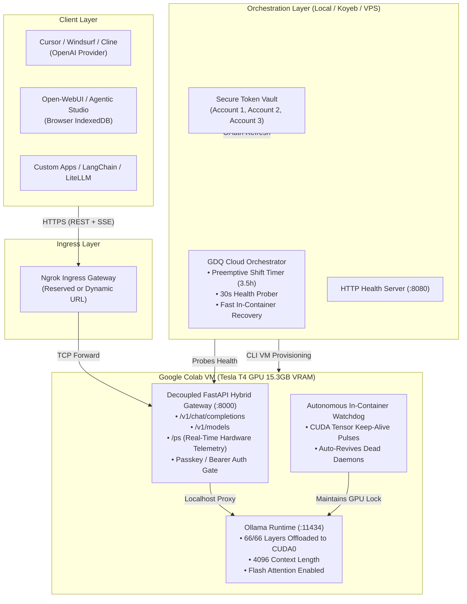

# 🏛️ Architecture Specification & Technical Mechanics

**Colab Router** transforms Google Colab into a high-availability, sovereign, OpenAI-compatible AI supercomputer. This document explains the underlying engineering design, memory mechanics, and failure mitigations.

---

## 1. System Topology

---

## 2. Memory Dynamics on Tesla T4 (15.3 GB VRAM)

A 27-Billion parameter dense model typically requires ~54 GB in FP16 precision. To execute a 27B model on a single Tesla T4 (15.3 GB VRAM), careful quantization and context window tuning are required:

| Parameter | Configuration | Memory Footprint |
| :--- | :--- | :--- |
| **Model Quantization** | `IQ4_XS` (Importance Matrix Quantization) | **13.73 GB** |
| **KV Cache (`num_ctx 4096`)** | 16-bit Float Context Cache | **~0.82 GB** |
| **CUDA Compute Buffers** | Fused Attention & Overhead | **~0.15 GB** |
| **Total VRAM Allocated** | **100% GPU Offload (66/66 Layers)** | **14.54 GB / 15.36 GB (95%)** |
| **Free Margin** | Safe Buffer against CUDA OOM | **~0.82 GB Free** |

### ⚠️ The CPU Offloading Trap
If context length is expanded to 8,192 or 16,384 on a 27B model, Ollama automatically spills 6 to 10 layers into CPU system RAM. 
- **100% GPU (66/66 layers):** **11.5 - 12.0 tokens/second**, first-token latency **0.84s**.
- **Partial CPU (60 GPU / 6 CPU):** **2.8 - 3.1 tokens/second**, first-token latency **12.5s**.

Colab Router enforces **100% GPU offloading** with `num_ctx 4096` to maximize token throughput and eliminate client timeouts.

---

## 3. Defeating Google Colab Idle Reaping

Google Colab enforces aggressive idle timeouts:
1. **Frontend Disconnect Timeout:** Closes VMs if no browser tab is active for ~30 minutes.
2. **GPU Idle Reaper:** Reaps VM if no CUDA kernels are scheduled for >20 minutes.
3. **Execution Block Timeout:** Terminates long running blocking cells if standard output is silent.

### GDQ Mitigations:
- **Detached Execution (`nohup`):** The payload runs as an independent Linux daemon detached from the Jupyter session.
- **Continuous CUDA Tensor Pulse:** Every 30 seconds, the watchdog schedules an in-memory PyTorch CUDA tensor multiplication (`torch.matmul(torch.randn(128, 128, device="cuda"))`). This keeps the CUDA kernel utilization non-zero without consuming measurable power.
- **Active Web Keep-Alive:** The built-in HTTP server on port 8080 allows free cloud host monitors (UptimeRobot, Koyeb, Render) to keep the orchestration chain active.

---

## 4. The 3-Account 24/7 Shift Rotation Formula

Google Colab enforces a daily compute unit limit per Google account on the free tier. A single free session typically yields 3.5 to 4.5 hours of continuous GPU compute before temporary throttling.

By cycling through **3 independent Google accounts**:
- **Shift Duration:** 3.5 hours per account.
- **Full Rotation Cycle:** $3 \times 3.5 = 10.5$ hours.
- **Account Rest Period:** $2 \times 3.5 = 7.0$ hours.

7 hours of rest is sufficient for Google's quota counter to fully replenish. Thus, the 3-account cycle sustains **24/7 autonomous compute indefinitely**.
